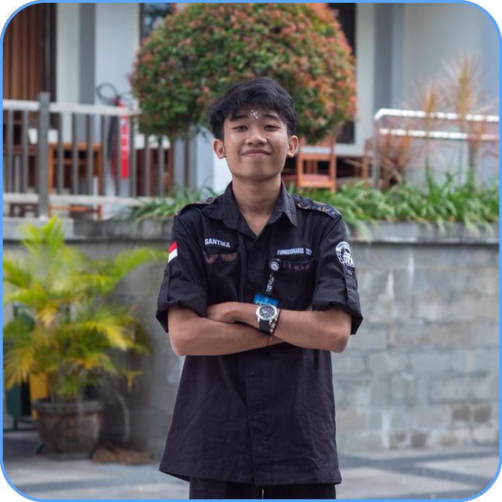
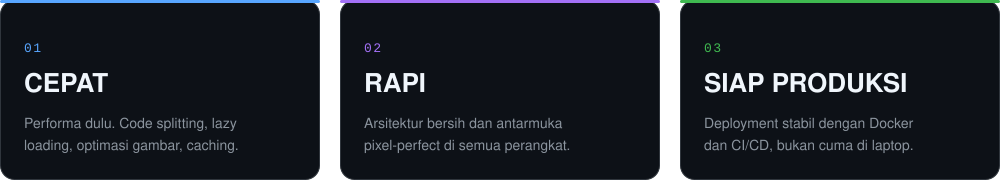
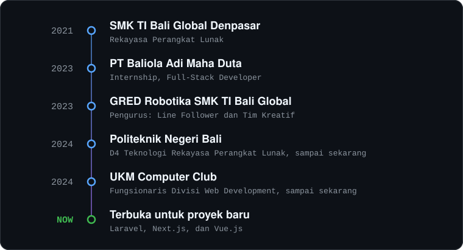

 

 

## 01 / About

**Full-Stack Developer** yang menghadirkan produk digital yang responsif dan terarsitektur rapi, dari desain awal hingga tahap deployment.

- **Pendidikan:** D4 Teknologi Rekayasa Perangkat Lunak, Politeknik Negeri Bali
- **Komunitas:** UKM Computer Club, Divisi Web Development
- **Fokus:** Web development, backend & API, implementasi UI, performa & deployment
- **Status:** Tersedia untuk proyek baru

 

## 02 / Philosophy

## 03 / Technology Stack

<b>Frontend</b> 

<b>Backend & Database</b> 

<b>DevOps & Deploy</b> 

## 04 / Selected Work

 

[**Lihat semua proyek di portfolio ↗**](https://santikakumara.web.id/)

**Dari repositori GitHub**

- [`Apotek`](https://github.com/urboysann/Apotek): web manajemen apotek (obat, stok, transaksi)
- [`Aquawash`](https://github.com/urboysann/Aquawash): pengelolaan usaha laundry
- [`projectHotel`](https://github.com/urboysann/projectHotel): reservasi hotel berbasis Java OOP
- [`TiketKeretaApi`](https://github.com/urboysann/TiketKeretaApi): pemesanan tiket kereta digital

## 05 / Journey

## 06 / GitHub Activity

<picture>
  <source media="(prefers-color-scheme: dark)" srcset="https://raw.githubusercontent.com/urboysann/urboysann/output/github-contribution-grid-snake-dark.svg" />
  <source media="(prefers-color-scheme: light)" srcset="https://raw.githubusercontent.com/urboysann/urboysann/output/github-contribution-grid-snake.svg" />
  
</picture>

 

## 07 / Connect

Punya proyek web yang ingin dibangun? Mari berdiskusi.

 

 

© 2026 Santika Kumara. Dibangun dengan kopi dan deadline.

