<div align="center">



<br />


<a href="https://santikakumara.web.id/"></a>

</div>

---

## 01 ── ABOUT

<table>
<tr>
<td width="260" align="center" valign="top">

</td>
<td valign="top">

**Full-Stack Developer** yang menghadirkan produk digital yang responsif dan terarsitektur rapi, dari desain awal hingga tahap deployment.

```yaml
name:      Santika Kumara
role:      Full-Stack Developer
education: D4 Teknologi Rekayasa Perangkat Lunak
campus:    Politeknik Negeri Bali
community: UKM Computer Club (Web Development)
status:    Tersedia untuk proyek baru
```

</td>
</tr>
</table>

---

## 02 ── PHILOSOPHY

> *Produk web yang baik itu cepat, rapi, dan siap dipakai.*

| Index | Pillar | Principle |
|:---:|---|---|
| `01` | **CEPAT** | Performa dulu: code splitting, lazy loading, optimasi gambar, dan caching |
| `02` | **RAPI** | Arsitektur bersih, antarmuka pixel-perfect, konsisten di semua perangkat |
| `03` | **SIAP PRODUKSI** | Deployment stabil dengan Docker dan CI/CD, bukan sekadar jalan di laptop |

```text
CADENCE // DESIGN ───> BUILD ───> OPTIMIZE ───> DEPLOY ───> REPEAT
```

---

## 03 ── TECHNOLOGY STACK

| Domain | Core Stack |
|---|---|
| **Frontend** |     |
| **Frameworks & UI** |      |
| **Backend** |     |
| **Database** |    |
| **DevOps & Deploy** |      |

---

## 04 ── SELECTED WORK

| # | Project | Jenis | Stack |
|:---:|---|---|---|
| `01` | **PNB EAGLES Season 9** | Website turnamen E-Sports | `Next.js` `Tailwind` `TypeScript` |
| `02` | **IntechFest** | Website festival teknologi | `Laravel` `Tailwind` `MySQL` |
| `03` | **Web Community** | Platform komunitas developer | `Vue.js` `TypeScript` `Tailwind` |
| `04` | **KORA Lifestyle** | E-Commerce | `HTML` `CSS` `JavaScript` |
| `05` | **DevVerse Academy** | Platform EdTech | `HTML` `CSS` `JavaScript` |
| `06` | **Melahin.id** | Eksplorasi manajemen sampah | `HTML` `CSS` `JavaScript` |

<div align="center">

[**LIHAT SEMUA PROYEK  ↗**](https://santikakumara.web.id/)

</div>

**Dari repositori GitHub**

- [`Apotek`](https://github.com/urboysann/Apotek): web manajemen apotek (obat, stok, transaksi)
- [`Aquawash`](https://github.com/urboysann/Aquawash): pengelolaan usaha laundry
- [`projectHotel`](https://github.com/urboysann/projectHotel): reservasi hotel berbasis Java OOP
- [`TiketKeretaApi`](https://github.com/urboysann/TiketKeretaApi): pemesanan tiket kereta digital

---

## 05 ── JOURNEY

```text
2021 ──●  SMK TI Bali Global Denpasar     // Rekayasa Perangkat Lunak
2023 ──●  PT Baliola Adi Maha Duta        // Internship · Full-Stack Developer
2023 ──●  GRED Robotika SMK TI Bali       // Line Follower · Tim Kreatif
2024 ──●  Politeknik Negeri Bali          // D4 Teknologi Rekayasa Perangkat Lunak
2024 ──●  UKM Computer Club               // Divisi Web Development
NOW  ──▶  Terbuka untuk proyek baru
```

---

## 06 ── GITHUB CADENCE

<div align="center">

<picture>
  <source media="(prefers-color-scheme: dark)" srcset="https://raw.githubusercontent.com/urboysann/urboysann/output/github-contribution-grid-snake-dark.svg" />
  <source media="(prefers-color-scheme: light)" srcset="https://raw.githubusercontent.com/urboysann/urboysann/output/github-contribution-grid-snake.svg" />
  
</picture>

<br />


</div>

---

## 07 ── CONNECT

<div align="center">

Punya proyek web yang ingin dibangun? Mari berdiskusi.

<br />

[](https://santikakumara.web.id/)
[](https://www.linkedin.com/in/santikakumara/)
[](https://instagram.com/santikakumara)
[](https://github.com/urboysann)

<br />

<sub>© 2026 SANTIKA KUMARA • DIBANGUN DENGAN KOPI & DEADLINE</sub>

</div>
